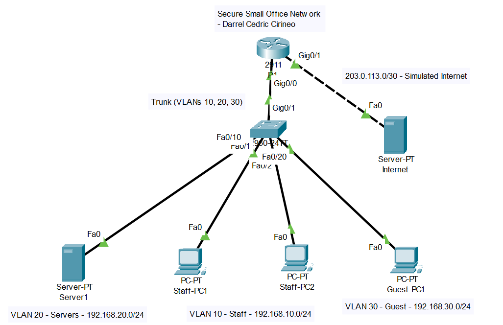

# Network Design

**Author:** Darrel Cedric Cirineo
**Tool:** Cisco Packet Tracer

## Goal

Design a small office network for about 20 users that separates staff, servers, and guests, so a compromised or untrusted guest device cannot reach internal systems. The design needed to be simple to manage, low cost, and easy to verify.

## Topology

| Component | Role |
|---|---|
| R1 (Cisco 2911) | Inter-VLAN routing, DHCP server, Guest ACL, link to the simulated internet |
| SW1 (Cisco 2960-24TT) | Layer 2 switch carrying VLANs 10, 20, and 30 |
| Server1 | Internal DNS server (`fileserver.office.local`) |
| Staff-PC1, Staff-PC2 | Employee workstations (VLAN 10) |
| Guest-PC1 | Visitor device (VLAN 30) |
| Internet | Simulated internet host (203.0.113.2) |

## Addressing Summary

| VLAN | Name | Subnet | Gateway |
|---|---|---|---|
| 10 | Staff | 192.168.10.0/24 | 192.168.10.1 |
| 20 | Servers | 192.168.20.0/24 | 192.168.20.1 |
| 30 | Guest | 192.168.30.0/24 | 192.168.30.1 |
| N/A | Simulated Internet | 203.0.113.0/30 | 203.0.113.1 |

Full details are in [`ip-table.md`](ip-table.md).

## Design Decisions

### Why VLANs?
Separating Staff, Servers, and Guest into different VLANs limits broadcast traffic and keeps visitor devices away from internal resources. Each group gets its own subnet, which also makes troubleshooting and policy enforcement easier.

### Why router-on-a-stick?
A single trunk link between SW1 (Gi0/1) and R1 (Gi0/0) carries all three VLANs. R1 has one subinterface per VLAN (Gi0/0.10, .20, .30), and each acts as that VLAN's default gateway. This is simple and cost-effective for a small office, since it needs no layer 3 switch.

### Why DHCP on the router?
Staff and Guest devices receive addresses automatically, which reduces manual setup and configuration errors. The first 20 addresses in each pool are excluded so they stay free for gateways and future static devices. Servers use static IPs so their addresses never change, which keeps DNS and any firewall rules reliable.

### Why an internal DNS server?
Server1 resolves `fileserver.office.local`, so users can reach resources by name instead of memorizing IP addresses. DHCP hands out Server1 as the DNS server to both Staff and Guest clients.

### Why a Guest ACL?
Guests need internet access but nothing internal. The ACL `GUEST-IN` is applied **inbound** on the Guest subinterface (Gi0/0.30), and rule order matters:

1. **Permit DHCP** so guests can obtain an address
2. **Permit DNS to Server1 only** so names resolve without opening the whole server VLAN
3. **Deny Guest to Staff** (192.168.10.0/24)
4. **Deny Guest to Servers** (192.168.20.0/24)
5. **Permit everything else** (internet access)

ACLs are processed top to bottom and stop at the first match, so the deny rules must come before the final permit. Without the first two permits, Guest devices would not be able to get an IP address or resolve names.

## Verification

All behavior was tested and documented in [`test-results.md`](test-results.md), with a screenshot for each test. Key results:

- Staff can reach Servers, other Staff devices, and the simulated internet (inter-VLAN routing works).
- DNS resolves `fileserver.office.local` for both Staff and Guest.
- Guest can reach the internet but cannot reach Staff or Servers.
- ACL match counters on R1 show the deny rules actively blocking traffic.

## Files in This Folder

| File | Description |
|---|---|
| `office-network.pkt` | Packet Tracer project file |
| `R1-config.txt` | Router running configuration |
| `SW1-config.txt` | Switch running configuration |
| `ip-table.md` | Full IP addressing plan |
| `test-results.md` | Verification tests with screenshots |

## What I Learned

- How VLANs, trunking, and router-on-a-stick work together to segment a network.
- Why ACL rule order matters, and how a missing permit rule can silently break DHCP or DNS.
- How to prove a configuration works with structured tests and device output, not just assumptions.
- The practical difference between stateless ACLs and stateful firewalls.
