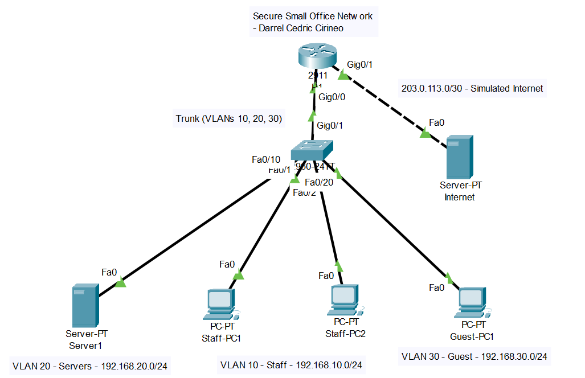

# Secure Small Office Network Lab

**Darrel Cedric Cirineo** | [LinkedIn](https://linkedin.com/in/cedriccirineo) | dcr.cirineo@gmail.com

A simulated small-office network that I designed, supported, and secured to practice
the skills used in IT support, networking, and cybersecurity roles.

## Skills Demonstrated

| Area | What I did |
|---|---|
| **Networking** | VLAN segmentation, trunking, router-on-a-stick, DHCP, DNS, access control lists, connectivity testing |
| **IT Support** | Linux user and group management, file permissions, Samba file sharing, ticket documentation, knowledge base writing |
| **Security** | Nmap scanning, SSH hardening (key-only login), host firewall (UFW), brute-force protection (fail2ban), re-scan verification |

## Tools Used

Cisco Packet Tracer, VirtualBox, Ubuntu Server, Kali Linux, Samba, Nmap, UFW, fail2ban, OpenSSH, Git/GitHub

## Project Overview

### 1. Network design ([details](01-network/README.md))
Designed a 3-VLAN office network (Staff, Servers, Guest) in Packet Tracer with router-on-a-stick
routing, DHCP, and an internal DNS server. A Guest ACL gives visitors internet access while blocking
them from Staff and Server networks. I verified the design with 10 documented tests
([results](01-network/test-results.md)).

### 2. IT support ([tickets](02-it-support/tickets.md) | [knowledge base](02-it-support/knowledge-base.md))
Built an Ubuntu file server with users, groups, permissions, and Samba shares, where Staff and IT
get different access. Reproduced and resolved **4 support tickets** (account reset, locked account,
DNS fault, high CPU) and wrote **3 knowledge base articles**.

### 3. Security assessment and hardening ([report](03-security/hardening-report.md))
Scanned my own server from Kali with Nmap, documented findings, then applied fixes and re-scanned
to verify them.

| Metric | Before | After |
|---|---|---|
| Open TCP ports | **[number]** | **[number]** |
| SSH password login | Enabled | Disabled |
| SSH root login | **[value]** | Disabled |
| Host firewall | None | UFW (deny by default) |
| Brute-force protection | None | fail2ban **[keep only if you captured a ban]** |

## Repository Structure
01-network/ Packet Tracer file, configs, IP table, test results
02-it-support/ Support tickets and knowledge base articles
03-security/ Hardening report and Nmap scan output
screenshots/ Evidence for every test and fix
lessons-learned.md
